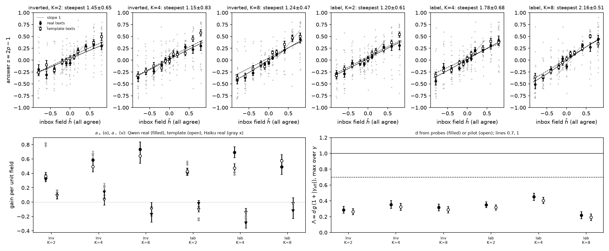
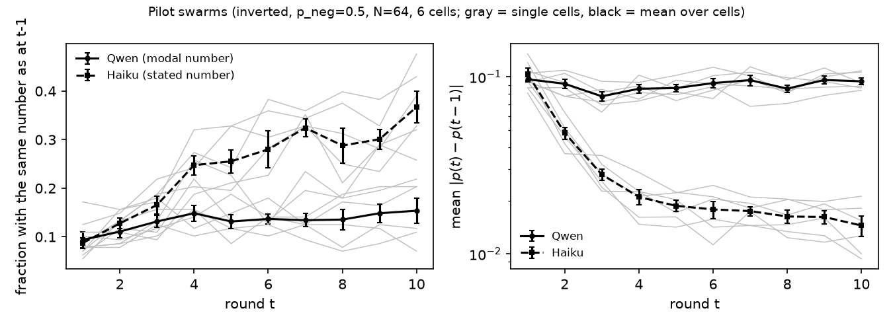

# 06-qwen-calibration: Qwen3.5-9B couples weakly to its peers, so no tested swarm is near the stability boundary or bistable

No (wording, K) cell brings a Qwen3.5-9B swarm near the stability boundary. Λ_max is at most 0.45 ± 0.05 (label
wording, K=4), and every cell's upper 2 s.e. bound is below 0.7. No conformity curve is bistable either. The fitted
conformity slopes are β_resp = 0.36–0.58 (s.e. 0.03–0.04), every curve has a single fixed point, and the steepest
local slopes (1.1–2.2) are what a smooth curve of slope about 0.5 produces under this run's noise.

The fixed rules give the overall verdict **inconclusive**, not "not supported". The reason is in how the rule was
written. It labels any steepest local slope above 1 that fails the other bistability conditions as
"inconclusive", and with a within-level s.d. of 0.28 and 20 replicates per level, the steepest of ten local slopes
lands above 1 by chance in every cell. On the substance, no cell is close to either regime. Qwen's gains are smaller
than Haiku's, and its answers carry about 2.5 times Haiku's noise. The noise does not come from reading out the
number; it comes from the sampled rationale. Unlike Haiku, the Qwen swarm never settles: answers keep moving by
about 0.09 per round through round 10.

## Gains with real Qwen messages (transfer.py design, 600 paired base probes per cell, paired bootstrap s.e.)

The fit is E[s] = tanh(a₊ f_A − a₋ f_D + a_p h_priv + c), with f the inbox field per unit K. Here d = ⟨1 − s²⟩ over
the real-arm answers. Λ_max is the largest of d·g·(1 + |γ_eff|) over γ ∈ {−1, 0, +1}, with g = √((a₊² + a₋²)/2K).

| wording, K | real a₊ | real a₋ | real a_p | template a₊ | template a₋ | real − tpl a₊ | real − tpl a₋ | g | d | Λ_max |
|---|---|---|---|---|---|---|---|---|---|---|
| inverted, 2 | 0.33 (0.05) | 0.08 (0.04) | 0.33 (0.01) | 0.36 (0.05) | 0.09 (0.04) | −0.03 (0.08) | −0.00 (0.05) | 0.17 (0.03) | 0.84 | 0.29 (0.04) |
| inverted, 4 | 0.59 (0.08) | 0.14 (0.08) | 0.32 (0.01) | 0.49 (0.07) | 0.03 (0.07) | +0.09 (0.10) | +0.11 (0.09) | 0.21 (0.03) | 0.83 | 0.35 (0.05) |
| inverted, 8 | 0.73 (0.11) | −0.17 (0.11) | 0.29 (0.01) | 0.64 (0.10) | −0.10 (0.09) | +0.09 (0.14) | −0.07 (0.15) | 0.19 (0.03) | 0.84 | 0.32 (0.04) |
| label, 2 | 0.42 (0.05) | −0.02 (0.04) | 0.32 (0.01) | 0.43 (0.05) | −0.10 (0.04) | −0.01 (0.06) | +0.08 (0.05) | 0.21 (0.02) | 0.85 | 0.35 (0.04) |
| label, 4 | 0.69 (0.08) | −0.29 (0.07) | 0.29 (0.01) | 0.47 (0.06) | −0.15 (0.06) | +0.22 (0.10) | −0.15 (0.09) | 0.27 (0.03) | 0.85 | 0.45 (0.05) |
| label, 8 | 0.49 (0.10) | −0.12 (0.11) | 0.26 (0.01) | 0.58 (0.09) | −0.02 (0.08) | −0.09 (0.12) | −0.10 (0.14) | 0.13 (0.03) | 0.86 | 0.22 (0.05) |

Each cell has n = 600 pairs. One call in the whole run went missing (conformity), and none in the transfer step. Four
patterns stand out:

- **The gains are weak.** At K=2, Qwen's real a₊ is less than half of Haiku's (0.33 against 0.80 inverted, 0.42
  against 0.54 label; HANDOFF.md).
- **Qwen partly adds up its inbox.** Its inverted a₊ grows from K=2 to K=8, whereas Haiku's falls from K=2 to K=4.
  Because g carries a 1/√K, the larger gains still don't raise g much: g ranges from 0.13 to 0.27.
- **The inverted wording barely switches the disagree channel on.** a₋ = 0.08 and 0.14 at K=2 and 4, and −0.17 at
  K=8. Under the label wording, disagree sources attract (a₋ < 0), as they do for Haiku.
- **Templates transfer for Qwen.** Unlike Haiku, real messages couple as strongly as templated ones within 2 s.e. in
  five of the six cells. The exception is label K=4, where real messages pull harder (a₊ +0.22 ± 0.10).

The stability numbers are robust to how d is defined:

- **Other definitions of d.** With d from the pilot's late rounds (0.76), Λ_max is 0.19–0.41. With √⟨d²⟩
  (theory/claim2.md §2), it is 0.22–0.46.
- **Own-answer memory (secondary).** The weight of the agent's own last answer at fixed inbox is κ_u = 0.17–0.28
  (s.e. 0.03) from the conformity probes with HEADS against TAILS own answers, which gives κ_lin = d·κ_u = 0.14–0.23.
  The static threshold with memory, Λ/(1 − κ_lin) at γ = +1, is at most 0.56 (label K=4); the rest are 0.25–0.46.
- **The uniform mode.** d·J̄ is at most 0.42 (label K=4), so the ferromagnetic mode is far from 1 as well.

## Conformity curves (all-agree inboxes, evidence 0.4, own last answer HEADS, 20 replicates per level)

| wording, K, texts | β_resp | steepest local slope | where | fixed points (fit / resolved crossings) | null mean of max slope | P(null ≥ observed) |
|---|---|---|---|---|---|---|
| inverted, 2, real | 0.36 (0.04) | 1.45 (0.65) | 0.0–0.1 | 1 / 0 | 1.32 | 0.32 |
| inverted, 4, real | 0.44 (0.04) | 1.15 (0.83) | −0.2 to −0.1 | 1 / 0 | 1.34 | 0.66 |
| inverted, 8, real | 0.53 (0.04) | 1.24 (0.47) | 0.4–0.6 | 1 / 0 | 1.33 | 0.56 |
| label, 2, real | 0.44 (0.03) | 1.20 (0.61) | 0.1–0.2 | 1 / 0 | 1.29 | 0.56 |
| label, 4, real | 0.48 (0.03) | 1.78 (0.68) | 0.1–0.2 | 1 / 0 | 1.31 | 0.09 |
| label, 8, real | 0.58 (0.04) | 2.16 (0.51) | 0.0–0.1 | 1 / 1 | 1.38 | 0.03 |
| template texts, six cells | 0.40–0.52 (0.03) | 1.10–1.67 | | 1 / 0 each | 1.15–1.50 | 0.14–0.68 |

Across the full range of fields, every curve rises from about −0.4 to +0.45 as h̄ goes from −0.8 to +0.8, which is
an average slope of about 0.5. Haiku's β_resp at K=8 was 0.77 ± 0.01 (experiments/03_calibration, all four evidence and history cells pooled).

The last two columns are an exploratory check, added after seeing the data and not part of the fixed rules. They
redraw the level means from the fitted tanh with each level's observed s.e. and ask how steep the steepest of the
ten slopes gets. Label K=8 has the only small P (0.03 for one cell out of twelve), and its steep step comes from a
dip at h̄ = 0 (level means 0.03, −0.13, 0.08 at h̄ = −0.1, 0, 0.1). A dip like that is a non-monotone fluctuation,
not a switch between two states.

## Noise floor: logprob beliefs against sampled numbers, and against Haiku

| statistic (in s = 2p − 1) | Qwen, logprob belief | Qwen, sampled number | Haiku (stated number) |
|---|---|---|---|
| within-level s.d., conformity replicates (rms over cells) | 0.275 | 0.287 | 0.107 (calib-20261125-conf, K=8, label) |
| residual s.d. of the real-arm transfer fits (rms over cells) | 0.247 | 0.266 | 0.099 (transfer-20261125) |

Reading the belief from logprobs removes the noise of sampling the number itself, which is
√(0.287² − 0.275²) ≈ 0.08 to √(0.266² − 0.247²) ≈ 0.10 in s. That is as large as Haiku's whole replicate noise.
Over all 23,184 calls, |p_logprob − p_sampled| averages 0.018 in p.

But the noise that remains is 0.25–0.28 in s, two and a half times Haiku's total. It comes from the sampled
rationale and message: the agent writes a different argument each time and then states a number that follows it.
So the logprob readout lowers Qwen's noise floor only by about 4% in s.d. (0.287 to 0.275), and Qwen stays far
noisier than Haiku. With weak gains and large noise, the swarm sits deep in the noise-dominated regime.

## Pilot swarm (inverted, p_neg=0.5, N=64, T=10, 2 replicas; the Haiku pilot's graphs, evidence and seeds)

| K, γ | m(0) → m(10) | D(10) | c1 | c2 | P_delta | Haiku c1 | Haiku c2 | modal number unchanged, t ≥ 6 (Qwen) | stated number unchanged, t ≥ 6 (Haiku) |
|---|---|---|---|---|---|---|---|---|---|
| 2, −1 | 0.16 → 0.06 | 0.15 | 0.51 | +0.31 | 1.33 | 0.72 | +0.44 | 0.17 | 0.22 |
| 2, 0 | 0.19 → 0.19 | 0.14 | 0.42 | +0.25 | 1.28 | 0.71 | +0.49 | 0.17 | 0.28 |
| 2, +1 | 0.14 → 0.15 | 0.19 | 0.63 | +0.32 | 1.78 | 0.80 | +0.60 | 0.18 | 0.29 |
| 4, −1 | 0.13 → 0.09 | 0.17 | 0.41 | +0.23 | 1.26 | 0.68 | +0.33 | 0.12 | 0.32 |
| 4, 0 | 0.17 → 0.09 | 0.24 | 0.55 | +0.31 | 1.47 | 0.68 | +0.40 | 0.10 | 0.39 |
| 4, +1 | 0.23 → 0.05 | 0.30 | 0.46 | +0.22 | 1.36 | 0.79 | +0.61 | 0.11 | 0.38 |

The pilot ran 8,064 calls with 0 missing. Every cell had a median valid mass of 0.99998 and a minimum of at least
0.992. Its main findings:

- **Qwen doesn't freeze.** The mean |Δp| per round stays at 0.078–0.101 in rounds 6–10, the same as at round 1,
  whereas Haiku's falls from about 0.1 to 0.013–0.020.
- **Qwen rarely repeats itself.** The modal stated number is unchanged in only 10–18% of late-round answers, against
  22–39% for Haiku with the same code on the same cells, and the displayed value in 9–17%. Public messages are almost
  never repeated verbatim by either model (Qwen 1–2%, Haiku 0–1%).
- **The replicas stay far apart.** D(10) = 0.14–0.30, and the replica-difference correlations are weaker than
  Haiku's (c1 = 0.41–0.63 against 0.68–0.80).
- **There's no period-4 signature.** c2 is positive at every γ, with no sign flip at γ = −1.
- **The swarm doesn't converge on the truth.** It drifts away in four of the six cells (m(0) → m(10)).
- **The agents move a lot, but not toward each other.** This fits the transfer gains: the motion comes from the
  noise of the rationale, not from coupling to peers.

## How it was checked

- The backend was validated in 06-qwen-smoke. Over the whole run (23,184 calls), 1 call was missing (malformed
  twice), 131 needed a retry (0.6%), and the valid mass was at least 0.95, with a median of 0.99998.
- The transfer fits reuse `experiments/05_swarm/transfer.py`'s `fit`, `base_probes`, `context` and `mirror` unchanged,
  with its pool pointed at the Qwen pilot. The same analysis code reproduces the Haiku real-arm gains in HANDOFF.md
  (inverted K=2: 0.80, 0.15).
- The thermal observables come from `design_lib.thermal_observables` through `05_swarm/analyze.load_run`. The
  unchanged fractions use one function for both models.
- The pipeline ran end to end on a fake engine before launch, and a reviewer read the definition twice.

## What wasn't checked, and judgement calls

- **K=8 pool.** The K=8 transfer probes draw their messages from the K=4 pilot pool, because there is no K=8 pilot
  cell. Both wordings draw from the inverted pilot's messages, as the Haiku design did.
- **Own-answer map.** The own last answer in the transfer probes uses Haiku's round-0 map (A_P = 0.42), so the design
  stays identical to transfer.py. Qwen's round-0 evidence gain (a_p ≈ 0.3) is a little lower.
- **What d leaves out.** d is held fixed in the bootstrap, so the Λ s.e. covers the gains only. The pilot and √⟨d²⟩
  variants bracket it, and moving d by ±0.05 would not change any verdict.
- **Untested settings.** Only evidence levels 0.4 and 1.4, one own-answer state for the curves, and p_neg = 0.5 were
  probed. A swarm at p_neg = 0 with all-agree ties has J̄ = a₊, so d·a₊ ≈ 0.62 at inverted K=8, the largest uniform-mode
  number here, still below 1. That was not run as a swarm.
- **The fixed bistability rule.** Its "inconclusive" branch fires on noise at this replicate count. That is a flaw in
  the rule as written, and it should be tightened before reuse: for example, require the slope's 2 s.e. bound above 1
  before calling a cell inconclusive.
- **Single draws.** The pilot is one graph and one evidence draw per cell, and it is exploratory.

## Cost

$2.61 estimated ($2.09 billed so far) for 4.4 h of A40, against a $6 budget and an 8 h cap. With 06-qwen-smoke
($0.49), this GPU phase has spent about $3.10 of its $40.

Data: `results/qwen-pilot-20261125*`, `results/qwen-transfer-20261125-*`, `results/qwen-conf-20261125-*`,
`results/qwen-calib/` (records and `summary.json`). Code: `run.py`, `analyze.py`, `plot.py` in this folder.
